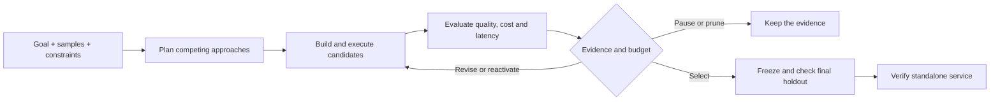

# Solve2Ship — From Goals to Working AI Solutions

[English](README.md) · [简体中文](README.zh-CN.md) · [Quick start](#quick-start) · [FAQ](docs/FAQ.md) · [Related work](docs/COMPARISONS.md)

**Solve2Ship (STS) is an open-source AI-native solution engineering project exploring Goal-to-Service:** describe an outcome, provide input samples and constraints, then let executable approaches compete through real evaluation and bounded iteration toward a working service.

**AI should explore how to solve a problem, as well as execute a workflow designed by a person.**

*Define the outcome. Let solutions compete. Ship the best.*

A task may need rules, a short Python program, a trained model, a prompt or a tool-using workflow. STS treats these as competing approaches. It selects using the available quality evidence, measured inference cost and latency; an agent does not receive a preference for being an agent.

**v0.13.0 engineering preview · [Apache-2.0](LICENSE).** The current implementation runs locally and supports a bounded set of candidate families. The complete autonomous engineering platform remains a development goal.

## How Goal-to-Service works



The search loop has real outputs, failures, revisions and stop conditions. Final test inputs stay sealed during search. Generated Python and model loading run only in reviewed, resource-limited Docker containers; model requests use a metered gateway outside those containers.

## What works today

| Area | Current preview | Still ahead |
| --- | --- | --- |
| Task definition | JSON/JSONL samples, natural-language outcome, optional labels and constraints; immutable revisions | Broader data intake and general natural-language constraint enforcement |
| Competing solutions | Rules, Prompt, Hybrid, isolated Python, numeric scikit-learn, bounded workflows and experimental tool-use agents | General skills, multi-agent systems, harnesses and broader ML |
| Eval-driven optimization | Optional frozen JSON Schema checks with unreviewed provenance; grouped splits, common-case evaluation, cost/latency receipts, bounded edits, conservative pruning and rollback | Calibrated evaluators and mature optimizer-library adapters |
| Delivery | Supported frozen winners exported as independently callable local HTTP source bundles | Production authentication, tenancy, credential vault and cloud hosting |
| User experience | Minimal Studio; English default, explicit 简体中文 in Settings | Broader accessibility and operating environments |

The architecture keeps candidate families extensible. “Autonomous AI engineering,” “cross-paradigm solution search” and “agentic AutoML” describe the problem space; they do not mean every planned capability is implemented. See the [architecture](docs/PRODUCT_ARCHITECTURE.md), [use cases](docs/USE_CASES.md) and [comparison scope](docs/COMPARISONS.md).

## Quick start

Python 3.13+ with SQLite; Node 24+ for tests. Basic local startup uses the Python standard library.

```sh
git clone https://github.com/runzhiyyds/solve2ship.git
cd solve2ship
make check
make run
```

Open http://127.0.0.1:8000. This is loopback-only development infrastructure, without production authentication, TLS or tenancy.

For real model-backed exploration, configure a supported model and an explicitly approved budget:

```sh
PYTHONPATH=src python3 -m solve2ship configure-model
PYTHONPATH=src python3 -m solve2ship authorize-budget --cny YOUR_APPROVED_LIMIT
PYTHONPATH=src python3 -m solve2ship model-status
```

Replace `YOUR_APPROVED_LIMIT` with your own cumulative authorization. Enter the key only in the hidden terminal prompt. Usage and unknown-charge reservations persist across restarts. The owner-only profile is local plaintext, not a production vault. The current paid gateway requires the reviewed DeepSeek Flash endpoint/model and a date-valid pricing policy; other providers need review before paid use.

Rules/Prompt/Hybrid do not require Docker. Python, numeric ML, workflows and tool-use agents require machine-specific runtime acceptance. The [usage guide](docs/USAGE.md) covers setup, supported delivery and independent service configuration.

### Try an outcome

Paste [the receipt inputs](examples/receipt-inputs.json) and [the Chinese outcome description](examples/receipt-outcome.zh-CN.txt) into Studio. The goal asks for item count and exact integer-cent totals from ordinary order notes. You supply the desired behavior; the planner proposes how to produce it.

These two public examples demonstrate task intake. Use enough distinct samples for independent validation and final checks; the example alone is not a benchmark or a service quality guarantee.

Prefer a local coding agent? The companion **[sts-skills](https://github.com/runzhiyyds/sts-skills)** project provides an installable preview and downloadable ZIP as a frontend-free way to apply the same goal → alternatives → evaluation → service discipline. Check its own release and compatibility notes before use; it is a separate deliverable.

## Evidence, including failures

The v0.13.0 suite has **157 Python tests and six Node tests** with the optional schema dependencies installed; base stdlib checks explicitly skip 11 schema-engine tests. Protocol fixtures are separate from real model and runtime acceptance.

In one small synthetic Chinese task, a tool-use agent selected the intended fee/date tools but returned the wrong final output shape. One measured edit still matched **0/6 validation labels**. The simpler Python candidate matched **6/6**, remained selected and passed **4/4 once-only final labels**, followed by six independent HTTP cases from both its private and exported service bundles. These are provided-label matches, not verified business accuracy or a general ranking of approaches.

A separate model/code workflow passed four final labels and real standalone serving checks with persistent budgets and request IDs. The [case notes](docs/USE_CASES.md#observed-acceptance-cases) explain the scope and missing evidence. This project claims no global optimum, guaranteed self-improvement, or benchmark superiority over related systems. Model-judge scores remain uncalibrated proxies.

## Documentation

| I want to… | Read |
| --- | --- |
| Run STS or use an exported service | [Usage / 使用说明](docs/USAGE.md) |
| Understand the system and trust boundaries | [Product architecture](docs/PRODUCT_ARCHITECTURE.md), [security](docs/SECURITY.md) |
| Decide whether STS fits my problem | [Use cases](docs/USE_CASES.md), [FAQ](docs/FAQ.md) |
| Compare the research and product scope | [AIDE ML, AutoML-Agent, Weco, AFlow and AutoGluon](docs/COMPARISONS.md) |
| Reuse a diagram or describe the project | [Media kit / 传播素材](docs/MEDIA_KIT.md) |
| Contribute or cite a version | [Contributing](CONTRIBUTING.md), [CITATION.cff](CITATION.cff) |
| Check changes and dependencies | [Changelog](CHANGELOG.md), [dependency and license inventory](docs/DEPENDENCIES.md) |

Push/PR checks and tested version-tag releases are configured. The initial GitHub billing lock was cleared on 2026-11-09. Workflows pin a supported Ubuntu/Python baseline; see [current hosted checks](https://github.com/runzhiyyds/solve2ship/actions/workflows/check.yml) alongside the local acceptance above. Only accepted product changes are synchronized—credentials, actual user data, local databases, agent context and development records are excluded.

## License and citation

[Apache-2.0](LICENSE). Copyright 2026 郭辰远 (Chenyuan Guo). Preserve [NOTICE](NOTICE). Third-party components retain their own licenses and notices. Runtime binaries and container images are not bundled; redistribution has separate obligations. No complete legal, CVE or formal SPDX certification is claimed.

Use [CITATION.cff](CITATION.cff) and identify the release tag or commit you used. Solve2Ship is software in development; no associated research paper or independently established algorithmic novelty is claimed.
