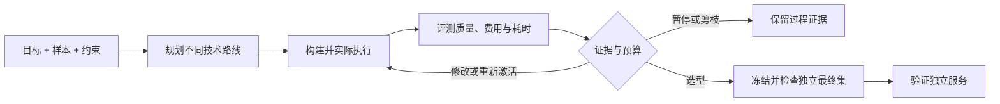

# Solve2Ship — 从目标到可运行的 AI 解决方案

[English](README.md) · [简体中文](README.zh-CN.md) · [快速启动](#快速启动) · [FAQ](docs/FAQ.md) · [相关项目](docs/COMPARISONS.md)

**Solve2Ship（STS）是一个开源 AI-Native 自主解决方案工程项目，探索 Goal-to-Service 范式：** 提供自然语言业务目标、输入样本与约束，让不同技术路线经过真实构建、评测与有界迭代，竞争成为可运行的服务。

**AI 不应该只执行人类设计好的 Workflow，还应该能够自主探索解决问题的技术路径。**

*定义目标。让方案竞争。交付最佳方案。*

任务可能只需要规则、一段 Python、一个训练模型，也可能需要 Prompt 或工具工作流。STS 让这些方案在同一任务上竞争，根据现有质量证据、实际推理费用与耗时选型，不因为某个方案是 Agent 就优先选择它。

**v0.14.0 工程预览 · [Apache-2.0](LICENSE)。** 当前实现为本机运行、范式范围明确的预览；完整自主工程平台仍在建设中。

## 从目标到服务



搜索保留真实输出、错误、版本和停止原因；最终测试数据在搜索期间封存。生成的 Python 及模型加载只能进入验收过、限制资源的 Docker 容器；模型请求走容器之外的计费网关。

## 当前能力与理想态

| 领域 | 当前预览 | 尚待完成 |
| --- | --- | --- |
| 定义任务 | JSON/JSONL、自然语言期望、可选标签与约束、不可变版本 | 更多数据入口、一般自然语言约束的可靠执行 |
| 方案竞争 | 规则、Prompt、混合、隔离 Python、数值分类器、有界工作流与实验性工具 Agent | 通用 Skill、多 Agent、Harness 与更广泛 ML |
| 评测驱动优化 | 可选冻结 JSON Schema 检查与待审阅来源； 数据分组划分、同样本评测、费用/耗时归因、有界修改、保守剪枝与回退 | 经校准的评测器、成熟优化库适配 |
| 交付 | 受支持方案导出本机 HTTP 源码服务包；无标签任务可明确选择最终输出复核 | 生产鉴权、多租户、凭据保险库与云托管 |
| 使用体验 | 极简 Studio，默认 English，在设置显式切换简体中文 | 更广泛的可访问性与运行环境 |

候选范式接口保持可扩展。Autonomous AI Engineering、Cross-Paradigm Solution Search、Agentic AutoML、Eval-Driven Optimization 是项目所在的问题领域，不代表规划中的能力已经全部实现。详见[产品架构](docs/PRODUCT_ARCHITECTURE.md)、[应用场景](docs/USE_CASES.md)与[对比范围](docs/COMPARISONS.md)。

## 快速启动

需要 Python 3.13+ 和 SQLite；测试还需要 Node 24+。基础本机启动使用 Python 标准库。

```sh
git clone https://github.com/runzhiyyds/solve2ship.git
cd solve2ship
make check
make run
```

打开 http://127.0.0.1:8000。当前服务仅用于本机开发，尚无生产鉴权、TLS 和多租户。

真实模型探索需要配置受支持的模型和明确批准的预算：

```sh
PYTHONPATH=src python3 -m solve2ship configure-model
PYTHONPATH=src python3 -m solve2ship authorize-budget --cny YOUR_APPROVED_LIMIT
PYTHONPATH=src python3 -m solve2ship model-status
```

把 `YOUR_APPROVED_LIMIT` 替换为你实际授权的累计预算。密钥只在终端隐藏输入，不要放进聊天、样本或浏览器。费用与未知预留不会因重启清零。本机配置仅所有者可读，但仍是明文，不是生产保险库。当前付费网关只接受核验过的 DeepSeek Flash 地址、模型和当天有效的价格策略；其他模型服务需先核验。

规则/Prompt/混合方案不需要 Docker；Python、数值 ML、工作流和工具调用方案需要本机运行验收。准备环境、导出与独立模型服务配置见[使用说明](docs/USAGE.md)。

### 试一个自然语言目标

将[订单输入样本](examples/receipt-inputs.json)和[中文期望输出](examples/receipt-outcome.zh-CN.txt)粘贴到 Studio：从日常订单备注中理解商品、数量与优惠，精确返回整数分金额。你定义期望，规划器提出实现方式。

这两条公开样本用于说明任务输入；独立验证和最终检查需要足够多的不同样本。示例本身不是基准测试，也不保证服务质量。

更习惯本地编程 Agent？配套 **[sts-skills](https://github.com/runzhiyyds/sts-skills)** 已发布可安装、可下载且无需前端的技能预览包，让本地 Agent 使用同样的“目标 → 多路线 → 评测 → 服务”方法。它是独立交付物，使用前请查看其实际发布与兼容性说明。

## 保留成功，也保留失败

v0.14.0 在安装可选结构校验依赖后通过 **178 项 Python、7 项前端测试**；基础环境明确跳过 11 项依赖校验引擎的测试。协议夹具与真实模型/运行验收分开记录。

无标签中文路由任务中，项目所有者实际复核并接受所选规则方案的四条一次性最终输出；
私有服务及导出 ZIP 各通过六条服务一致性 HTTP 检查。这是小型合成案例的用户接受，
不能视作业务准确率。详见 [v0.14 发布证据](docs/releases/v0.14.0.md)。

一次小型合成中文任务中，工具 Agent 选对了费用/日期工具，却丢失最终输出结构；一次真实修改后仍为 **0/6 验证标签匹配**。更简单的 Python 为 **6/6**，被系统保留并通过 **4/4 一次性最终标签检查**，私有包和实际导出 ZIP 各通过六条独立 HTTP 用例。这些只是未核验标签的一致性，不是业务准确率或不同技术路线的普遍排名。

另一次模型与代码组合通过四条最终标签及真实独立服务检查，验证了持久预算和请求编号防重放。[案例说明](docs/USE_CASES.md#observed-acceptance-cases)列明范围与缺失证据。项目不宣称全局最优、保证自我改进、优于相关项目的基准结果，模型裁判分仍是未校准代理值。

## 文档入口

| 我想…… | 阅读 |
| --- | --- |
| 启动 STS 或使用导出服务 | [使用说明](docs/USAGE.md) |
| 理解系统与信任边界 | [产品架构](docs/PRODUCT_ARCHITECTURE.md)、[安全说明](docs/SECURITY.md) |
| 判断是否适合我的问题 | [应用场景](docs/USE_CASES.md)、[FAQ](docs/FAQ.md) |
| 对比研究与产品范围 | [AIDE ML、AutoML-Agent、Weco、AFlow、AutoGluon](docs/COMPARISONS.md) |
| 复用架构图或介绍项目 | [传播素材](docs/MEDIA_KIT.md) |
| 贡献或引用版本 | [贡献说明](CONTRIBUTING.md)、[CITATION.cff](CITATION.cff) |
| 查询更新与许可 | [版本变动](CHANGELOG.md)、[依赖与许可证](docs/DEPENDENCIES.md) |

已配置推送/PR 检查和先测试后发布的版本工作流。2026-11-09 账户计费锁已解除，运行环境固定为受支持的 Ubuntu/Python 组合；[当前托管检查](https://github.com/runzhiyyds/solve2ship/actions/workflows/check.yml)与上述本机验收分别列示。只同步验收通过的产品内容，密钥、真实用户数据、本机数据库、Agent 上下文与开发记录不公开。

## 许可证与引用

[Apache-2.0](LICENSE)，Copyright 2026 郭辰远（Chenyuan Guo），请保留 [NOTICE](NOTICE)。第三方组件保留各自许可，运行环境二进制和容器镜像不随源码打包，分发义务另行履行。没有完整法律、CVE 或正式 SPDX 认证声明。

引用请使用 [CITATION.cff](CITATION.cff)，注明实际使用的标签或提交。STS 是持续开发的软件，尚无配套研究论文或独立证实的算法创新声明。
