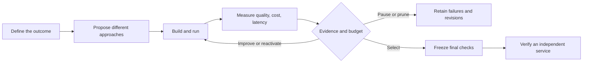

# Solve2Ship media kit / 项目传播素材

[Home](../README.md) · [Chinese introduction](../README.zh-CN.md) · [Case scope](USE_CASES.md) · [Related work](COMPARISONS.md)

Reusable copy and diagrams for people describing the project. Drafts below have **not been posted** to social platforms. Match every capability claim to the release being discussed. Publishing a document in this repository does not grant permission to post from another person's account.

## Identity

- **Name:** Solve2Ship (STS).
- **Slogan:** From Goals to Working AI Solutions.
- **Process line:** Define the outcome. Let solutions compete. Ship the best.
- **Definition:** An open-source AI-native solution engineering project exploring Goal-to-Service: samples and an outcome lead to competing executable approaches, real evaluation, bounded iteration and supported standalone service delivery.
- **Technical thesis:** AI should explore technical paths for solving a problem, as well as execute human-designed workflows.
- **Stage:** Engineering preview. General agents/harness, calibrated evaluation and production hosting remain incomplete.
- **Canonical source:** https://github.com/runzhiyyds/solve2ship
- **Local-agent companion:** https://github.com/runzhiyyds/sts-skills — check its own release and compatibility notes.

中文定义：Solve2Ship 是探索 Goal-to-Service 的开源 AI-Native 自主解决方案工程项目。用户提供样本、自然语言目标和约束，不同技术路线经过真实构建、评测与有界迭代，竞争成为可运行的服务。当前为工程预览，不是完整生产平台。

## Reusable flow diagram

The diagram describes the STS process. Show the actual registered candidate families and current delivery limitations alongside it; do not substitute the diagram for proof that a task ran.

## Draft: Hacker News / technical Reddit

**Title:** Show HN: Solve2Ship — let rules, code, ML and model workflows compete for a task

I'm building Solve2Ship, an Apache-2.0 engineering preview of Goal-to-Service. You provide input samples and the desired outcome; it constructs and evaluates executable alternatives, retains failures, makes bounded revisions and verifies supported winners as independent local services.

A small Chinese tool-selection task produced a useful failure: the agent called the right tools but lost the final output structure. An edit did not improve its six validation matches. Python won and passed the once-only final and service checks. This isn't a general benchmark; it illustrates why the architecture lets a simple program win.

Current scope includes isolated Python, numeric scikit-learn, prompts, hybrids and bounded workflows/tools. General agents, calibrated evaluation and production hosting are unfinished. I'd value feedback on cross-paradigm budget allocation and evaluating natural-language goals without treating model-judge scores as truth.

Source and limitations: https://github.com/runzhiyyds/solve2ship

## Draft: X / LinkedIn

Solve2Ship explores Goal-to-Service: define an outcome, let executable approaches compete, then verify a standalone service.

The question isn't “how many agents?” It's “which approach works for this task, at what cost, with what evidence?” Rules, Python, ML, prompts and bounded workflows can all enter the comparison.

Apache-2.0 engineering preview. Real failures stay visible; no guaranteed self-improvement or benchmark-superiority claim. Code, current limits and case notes: https://github.com/runzhiyyds/solve2ship

## 中文技术帖：知乎 / B站 / 中文社区

**标题备选：** 不先决定用 Agent：从自然语言目标到可运行服务的跨方案探索

Solve2Ship 的核心想法：AI 不只执行人类设计好的 Workflow，还应该探索解决问题的技术路径。输入样本与目标后，让规则、脚本、ML、Prompt、工作流等方案经过真实评测，在预算内迭代，最终验证可独立调用的服务。

一个小型中文验收中，Agent 选对了计算工具，却丢失最终 JSON 结构；修改后仍未达标。Python 因实际证据胜出，随后通过最终检查与独立服务验证。这不证明 Agent 普遍更差，而是说明选型应服从任务与证据。

当前为 Apache-2.0 工程预览，通用多 Agent/Harness、可信评测与生产托管仍待完成。源码与能力边界：https://github.com/runzhiyyds/solve2ship

## Demo outline for video or a technical article

1. State a concrete outcome and show representative, non-sensitive samples.
2. Show what the planner actually proposed and which runtimes were available.
3. Compare outputs on the same cases; expose a failure, a measured edit and its result.
4. Explain why the selected approach won, including cost and evaluation uncertainty.
5. Stop the STS controller and call the actual exported service independently.
6. End with the observed limits and release/commit, not a generalized accuracy claim.

Use a fresh authorized run when recording; screenshots and illustrative examples are not live execution. Any paid call needs a budget and suitable runtime. A short demo should identify edited segments, fixture material or pre-recorded evidence rather than presenting them as real-time results.

## Research questions worth sharing

- When is a workflow or agent worth its added inference cost over code or ML?
- How should search allocate a limited budget across different candidate families?
- How can evaluators derived from natural-language goals be calibrated with less labeling?
- How should a search preserve promising but uncertain candidates without wasting budget?

These are questions under investigation, not published findings. For quotations or experiment claims, link to [versioned software citation](../CITATION.cff) and [case boundaries](USE_CASES.md). Clear definitions, source links and precise evidence help readers and search systems understand the project; they do not guarantee ranking, recommendation or citation by a search/AI platform.
